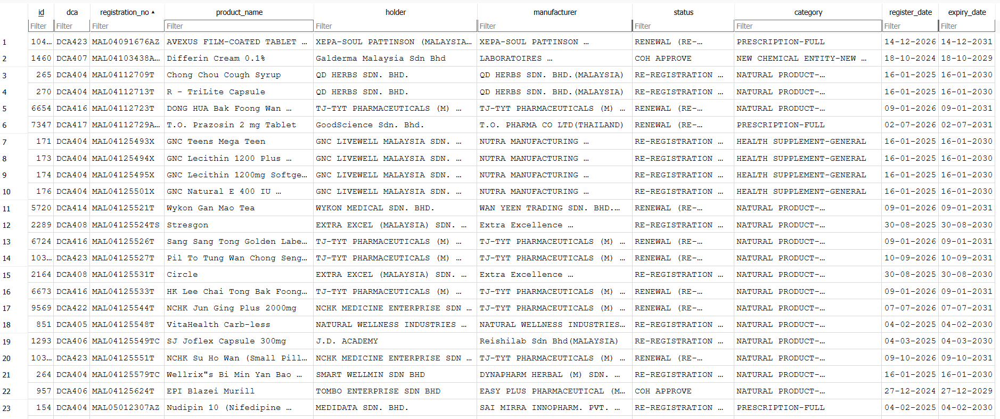

# NPRA Automation

Playwright + Python pipeline that downloads approved product PDFs from NPRA and stores the extracted table data in SQLite.

## What it does

1. **Historical Backfill** — Uses Playwright to navigate the NPRA page and download every PDF from DCA404 (Jan 2025) to the latest available month.
2. **Database Storage** — Parses each PDF's product table with `pdfplumber` and stores 8 fields per product (registration no., product name, holder, manufacturer, status, category, register date, expiry date) in SQLite.
3. **Recurring Monitor** — On re-runs, detects and processes only new documents. Already-downloaded PDFs and already-imported records are skipped.

## Requirements

- Node.js 18+
- Python 3.10+
- Chromium (installed by Playwright)

## Setup
### 1. Install Node deps
```bash
cd npra-automation
npm install
```
### 2. Install Playwright browser
```bash
npx playwright install chromium
```
### 3. Create and enter Python venv
```bash
python -m venv .venv
.venv\Scripts\Activate         
```

### 4. Install Python deps
```bash
pip install pdfplumber
```
## Usage

```bash
# Step 1: download PDFs (DCA404 to latest)
node src/scrape.js

# Step 2: parse PDFs and store into SQLite
python src/parse.py
```

Run both commands again later to pick up newly published documents. Nothing is re-downloaded or re-imported.

## Files

| File | Purpose |
|------|---------|
| `src/scrape.js` | Playwright script - fetch PDF list, download new PDFs to `downloads/` |
| `src/parse.py` | pdfplumber script - parse PDFs, insert records into `npra.db` |
| `src/explore.js` | One-off script to inspect the NPRA page structure (debug only) |
| `src/test-download.js` | One-off script to test a single PDF download (debug only) |
| `src/check_samples.py` | Random sample inspection of DB rows |
| `src/count_data.py` | Per-DCA row counts |
## Database schema

```sql
CREATE TABLE products (
    id              INTEGER PRIMARY KEY AUTOINCREMENT,
    dca             TEXT,
    registration_no TEXT,
    product_name    TEXT,
    holder          TEXT,
    manufacturer    TEXT,
    status          TEXT,
    category        TEXT,
    register_date   TEXT,
    expiry_date     TEXT,
    UNIQUE (registration_no, dca, status)
);
```

The UNIQUE constraint prevents the same `(registration_no, dca, status)` from being inserted twice, while allowing a product to appear with different statuses in the same meeting (e.g. `COS - Approved` and `RE-REGISTRATION (RENEWAL)`).

## Design notes

- **Download detection** — Playwright treats PDF responses as downloads; `page.waitForEvent('download')` is used instead of `response.body()`.
- **Idempotent re-runs** — Both scripts detect existing state before processing:
  - `scrape.js` filters out PDFs already present in `downloads/` (`fs.existsSync`).
  - `parse.py` skips DCAs already present in the database (`SELECT COUNT(*) WHERE dca = ?`).
  - As a safety net, `INSERT OR IGNORE` combined with the `UNIQUE (registration_no, dca, status)` constraint prevents duplicate rows even if the detection step misses something.
- **Table parsing** — Each PDF page is scanned; the header row may or may not be present (continuation pages often skip it). Column indexes are resolved from the header whenever it appears, and reused across subsequent pages of the same file.
- **Whitespace cleanup** — `clean()` collapses newlines and repeated whitespace, and joins hyphenated line breaks (e.g. `RE-\nREGISTRATION` becomes `RE-REGISTRATION`). Enum variants are preserved as they appear in the source PDFs.

## Sample output



Sample export (3 rows per DCA): [samples/sample-export.csv](./samples/sample-export.csv)
## Output

- `downloads/` — downloaded PDFs, named `DCA404.pdf`, `DCA405.pdf`, ...
- `npra.db` — SQLite database with the `products` table

Both are generated at runtime and excluded from version control via `.gitignore`.